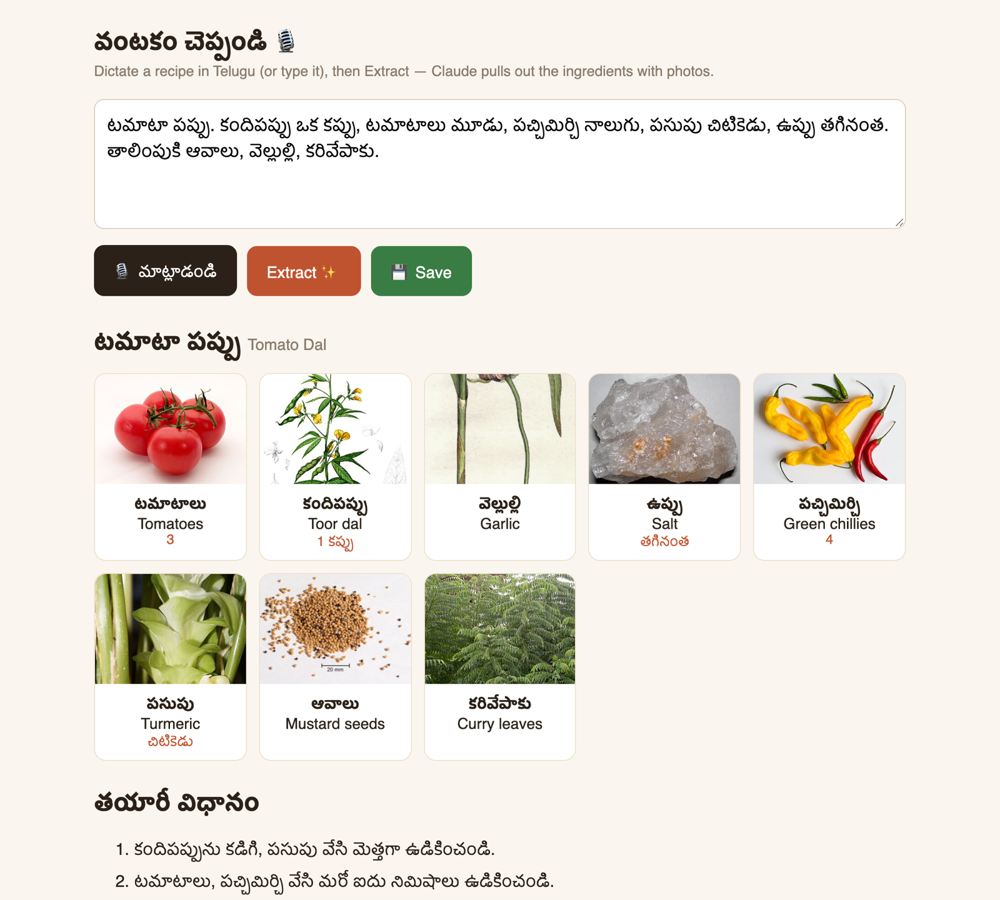
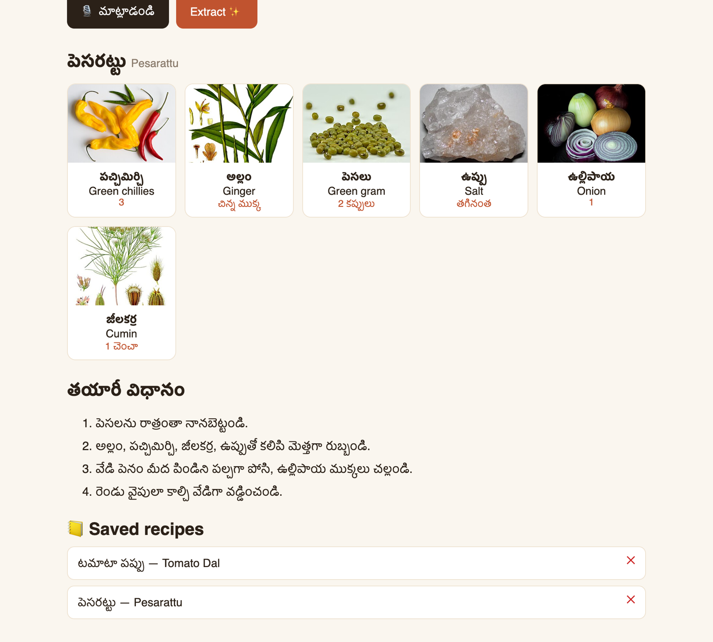

# Telugu Recipe

Say a recipe out loud in Telugu and get back a clean card: the dish, every ingredient with a photo and its
English name, and the steps. One Node file, one HTML page, no dependencies; the extraction runs through the
`claude` command-line tool already on your Mac.



## Why

Family recipes in Telugu-speaking homes are mostly spoken, not written: "కందిపప్పు ఒక కప్పు, పచ్చిమిర్చి నాలుగు…".
Typing them is slow, recipe apps assume English, and speech-to-text alone gives a wall of words with no
structure. This turns the spoken version into something you can shop from, and shows a picture of each
ingredient so an English-speaking cousin knows that కరివేపాకు is curry leaves.

## What it does

- **Telugu dictation in the browser.** Uses the Web Speech API with `te-IN`, continuous, with interim results
  shown live. Typing or pasting works too.
- **Structured extraction by Claude.** The server runs `claude -p` with a prompt that asks for one JSON object:
  dish (Telugu and English), ingredients (Telugu, English, quantity as dictated, Wikipedia title), and steps kept
  in Telugu. It tolerates speech-recognition errors and mixed Telugu–English.
- **Ingredient photos without an image API.** Each ingredient's Wikipedia title goes to the free, CORS-open
  `page/summary` endpoint and the thumbnail is used. The model picks the article most likely to have a photo
  ("Toor dal" becomes "Pigeon pea", "curry leaves" becomes "Curry tree").
- **Saved recipes stay in the browser.** Save keeps the recipe, photos included, in `localStorage`; click one to
  reopen it, ✕ to delete it. Nothing is written on the server.
- **Zero dependencies.** `server.mjs` is about 70 lines of `node:http` and `child_process`.

## Screenshots

| | |
|---|---|
|  |  |
| Recipe | Saved |

*Screenshots use the made-up recipes in `Tools/sample-recipes.json` — nobody's family recipes. Ingredient photos
are Wikipedia thumbnails fetched live, credited below.*

## Quick start

Needs Node 18+ and the [Claude Code](https://docs.anthropic.com/en/docs/claude-code) CLI, signed in.

    npm run dev        # http://127.0.0.1:4747

Open it in Chrome, press **మాట్లాడండి** and speak, then **Extract**. Extraction takes 10–60 seconds.

To try it without a microphone, paste the `dictation` line from `Tools/sample-recipes.json` into the box.

## Requirements

| | |
|---|---|
| OS | macOS or Linux |
| Runtime | Node 18+ (no packages) |
| Claude | the `claude` CLI on `PATH`, or at `~/.claude/local/claude`, logged in |
| Browser | Chrome for Telugu dictation (its recognition runs on Google's servers, so it needs internet). Safari and Firefox can type but not dictate Telugu |

## How it's organised

```
server.mjs     HTTP server on 127.0.0.1:4747: serves the page, POST /extract runs claude -p
index.html     the whole UI: dictation, extraction call, Wikipedia photos, saved recipes
Tools/         sample recipes and the screenshot script
```

[docs/ARCHITECTURE.md](docs/ARCHITECTURE.md) explains the pieces and their trade-offs;
[docs/BUILDING.md](docs/BUILDING.md) covers running, changing the prompt, and regenerating screenshots.

## Notes and limitations

- Recipe text from the model is inserted as HTML without escaping. That is fine for a page only you open on
  `127.0.0.1`; escape it before serving this to anyone else.
- Every extraction is a full `claude -p` run against your Claude plan's usage.
- Photos depend on Wikipedia having a thumbnail; when it doesn't, a placeholder is shown.

## Contributing

Pull requests are welcome.

- `node server.mjs --check` tests the JSON parsing; then extract one real recipe end to end.
- Prompt changes go in `PROMPT` in `server.mjs`; keep the JSON shape or update `render()` in `index.html` with it.
- Use the sample recipes. Never commit someone's real recipes or voice recordings.
- Good first projects: escaping model output, export to Markdown or PDF, other Indian languages (`rec.lang`).

## Credits and licence

Telugu Recipe is MIT licensed — see [LICENSE](LICENSE).

- Ingredient photos come from [Wikipedia](https://www.wikipedia.org/) and Wikimedia Commons at run time, each
  under its own licence (mostly CC BY-SA); none are stored in this repository.
- Extraction uses [Claude Code](https://docs.anthropic.com/en/docs/claude-code) by Anthropic, under its own terms.
  Claude is a trademark of Anthropic; this project is not affiliated with Anthropic.
